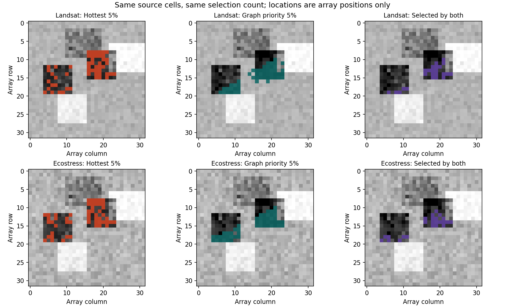

# Bundled-array comparison: hot cells versus graph priority

This is a **computational disagreement study**, not a field-validation or impact study. It uses two source-labeled arrays already bundled in the repository (Landsat 32×32, ECOSTRESS 32×32). The present metadata does not identify acquisition scenes or dates, georeferencing, quality masks, or a reproducible source-to-array processing chain. The arrays must therefore not be described here as independently verified Boston satellite observations or matched locations across sensors.

## Fair comparison within each array

Both methods receive the **same finite cells** after the repository's 2nd/98th-percentile normalization. The simple baseline selects the highest normalized-LST 5% of cells. The graph method builds the repository's eight-neighbor weighted graph without NDVI, selects a Fiedler-sweep boundary, finds least-cost links to the coolest 5% of cells, and ranks the boundary by `0.65 × normalized heat + 0.35 × poor modeled cooling linkage`. The boundary is dilated by two array cells as in the pipeline. Each method selects exactly 52 cells. Ties use row-major order. Alpha is 3 by default; 1 and 5 are sensitivity checks. No location coordinates, field labels, or intervention outcomes enter either ranking.

## Results

| Bundled array | Alpha | Cells per method | Overlap | Jaccard overlap | Mean heat: simple / graph | Mean poor modeled access: simple / graph |
|:--|--:|--:|--:|--:|:--|:--|
| Landsat | 1 | 52 | 26 | 0.333 | 0.972 / 0.907 | 0.316 / 0.275 |
| Landsat | 3 | 52 | 24 | 0.300 | 0.972 / 0.856 | 0.390 / 0.348 |
| Landsat | 5 | 52 | 22 | 0.268 | 0.972 / 0.841 | 0.491 / 0.433 |
| ECOSTRESS | 1 | 52 | 26 | 0.333 | 0.967 / 0.902 | 0.337 / 0.282 |
| ECOSTRESS | 3 | 52 | 24 | 0.300 | 0.967 / 0.891 | 0.414 / 0.344 |
| ECOSTRESS | 5 | 52 | 22 | 0.268 | 0.967 / 0.829 | 0.509 / 0.422 |

At default alpha 3, the overlaps are Landsat 24/52 (Jaccard 0.300), ECOSTRESS 24/52 (Jaccard 0.300). The graph rule includes modeled access and restricts priority to a candidate boundary, so a different selection is plausible. **The graph-selected cells have both lower mean normalized heat and lower mean modeled poor access than the simple-map cells in these arrays.** Those internal descriptors do not support claiming the graph selection is better; its distinct purpose is highlighting a structural boundary. The comparison demonstrates **different selection logic**, not better site selection. Similar results across the two arrays are not independent replication because the arrays' provenance, spatial alignment, and relationship are unverified.

## What would make this an empirical benchmark

Recover original product identifiers, acquisition times, georeferencing, quality masks, units, processing code, and exact input hashes. Define independent site or route-segment outcomes before inspecting either ranking. Give both methods the same candidate budget and blinded field-review effort, include sites favored by either and a background sample, and publish exclusions, disagreement, uncertainty, and null results. Local review or measured outcomes are still required to say which method is more useful. A cooling-effect claim additionally needs the design in the [impact evidence protocol](IMPACT_EVIDENCE_PROTOCOL.md).

## Reproduce and audit

Run `python scripts/compare_bundled_heat_maps.py` from the repository root. The script uses the same graph and pipeline functions as the app, writes [machine-readable results](final_paper_assets/bundled_map_comparison.json), and regenerates the figure and this report. Source file hashes are in the JSON. The repository's [thermal metadata](../data/metadata/thermal_sources.json) provides source labels but not scene-level provenance. Official [USGS Landsat Level-2 documentation](https://www.usgs.gov/landsat-missions/landsat-collection-2-level-2-science-products) describes the scene metadata needed for a stronger study; [EPA measurement guidance](https://www.epa.gov/heatislands/measuring-heat-islands) explains why surface maps and lived heat need different observations.
