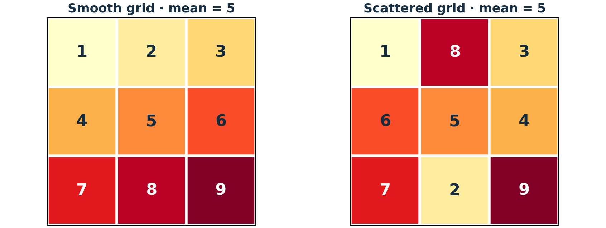
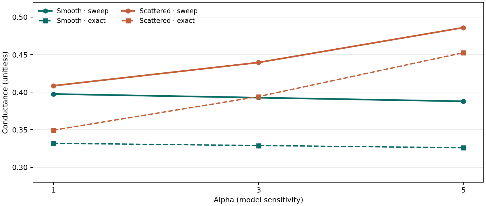

## Abstract

When a community studies heat, an average temperature can hide where warm and cool places sit next to each other. I tested whether Urban Heat Democratization's graph method detects that missing spatial information. I arranged the numbers 1 through 9 into two different 3-by-3 grids. Their means and histograms are identical. Using the project's open-source code, I built a weighted neighbor graph for each grid, measured its second normalized-Laplacian eigenvalue, found a candidate cut with the implemented spectral sweep, and checked that cut against all 255 distinct cuts. I repeated the comparison at three sensitivity settings. At the project's default alpha of 3, sweep conductance was 0.3927 for the smooth grid and 0.4396 for the scattered grid; the exact minimum also differed. These results support a precise conclusion: arrangement changes this model's structural answer even when a mean cannot distinguish the inputs. They do not measure a person's heat exposure, prove that a cooling site is reachable, or predict an intervention's benefit. I care about the distinction because a public map should give residents a question they can investigate, together with the evidence and assumptions they need to challenge its answer.

## Acknowledgements

This paper uses the public work of the U.S. Environmental Protection Agency, the U.S. Geological Survey, urban heat researchers, and graph theorists named in the Works Cited. I also acknowledge the knowledge residents have about shade, locked gates, dangerous crossings, and the hours when heat is hardest to bear. No community participant, mentor, school, or partner has been claimed as a contributor to this experiment without confirmation.

## Introduction and Background Research

I picture someone waiting for a bus on a hot afternoon. A satellite may show a warm roof or road nearby. The person needs to know whether the stop has shade at that hour and whether relief is actually accessible. The Environmental Protection Agency distinguishes measurements of surface temperature from measurements of air temperature (U.S. Environmental Protection Agency, n.d.). The U.S. Geological Survey explains how its land-surface-temperature product must be scaled before pixel values can be interpreted as temperature (U.S. Geological Survey, n.d.). Even a correctly processed surface image cannot tell us whether a park is open or a crossing is safe.

Heat is also an issue of fairness. Hsu and colleagues found unequal exposure to surface urban heat island intensity across major U.S. cities (Hsu et al., 2021). The Intergovernmental Panel on Climate Change describes how urban climate risks interact with poverty, infrastructure, and justice (Intergovernmental Panel on Climate Change, 2022). These studies explain why the distribution of heat deserves attention. They do not turn my nine teaching cells into a measure of anyone's exposure or health. A responsible tool has to keep those claims separate.

Urban Heat Democratization starts with prepared land-surface-temperature (LST) values and, when available, a vegetation layer. It connects neighboring valid cells with weights that depend on the local LST gradient and vegetation. It then asks where the resulting *chosen graph* has a weak connection. A second calculation estimates modeled linkage to cells that look relatively cool or green. These are planning clues. They are not measurements of heat flow, walking access, or cooling caused by a tree (Ravikumar, 2026a).

An average hides arrangement. If I scramble nine values, their mean stays fixed while their neighbors change. A graph built from neighboring values can therefore answer a question that the mean cannot. This project did not invent Laplacians, spectral cuts, or shortest paths. Its contribution is to connect established methods to an inspectable civic workflow: show the input, show the rule, show the result, and state what would disprove its usefulness. The project's civic guide asks readers to start with one local decision, examine the evidence label, add local knowledge, and choose a next evidence step (Ravikumar, 2026d). That sequence gives a resident a way to question a map rather than accept its ranking as a verdict.

## Purpose

I want to test whether the graph method notices a change in spatial arrangement that a mean and histogram miss. I also want to test the quality of its candidate cut against an exact answer on a small graph. Those tests make one part of the tool checkable before anyone asks whether it helps a real community decision.

## Problem

When the same nine values are placed differently in a 3-by-3 grid, does the declared graph produce different structural scores even though the mean and histogram stay the same? What does that result establish, and what remains untested?

## Hypothesis and Engineering Goals

**If** I rearrange the same nine values while holding the grid size and graph rules fixed, **then** at least one structural score will change, **because** edge weights depend on local neighbors, not only on the set of values. This predicts a difference, not a direction for every score. My engineering goal is a repeatable tool that exposes the input, calculation, candidate cut, and limits instead of presenting a mysterious “best place” label.

## Variables and Constraints

The main independent variable is the **position** of the nine values. The smooth and scattered grids each contain {1, 2, 3, 4, 5, 6, 7, 8, 9}. I separately vary the edge sensitivity parameter alpha across 1, 3, and 5 to see whether the result depends on that choice. The dependent variables are the second normalized-Laplacian eigenvalue (lambda 2), the conductance of the implemented sweep cut, and the exact minimum conductance. Within each comparison, I keep the grid size at 3 by 3, use four-neighbor connections, omit vegetation, keep beta at zero, and use the same normalization and code. The smooth grid is the comparison condition. The values are **unitless teaching numbers**, not degrees Celsius or a Boston sample.

The main constraint is that this is a computer experiment on nine cells. It cannot test human heat exposure, citywide performance, shade, routes, or project outcomes. Exact enumeration is practical for nine nodes but not for a full city grid. The pipeline's optional two-raster path also does not verify that two inputs share a coordinate system or pixel alignment; a real study must check that first (Ravikumar, 2026b).

## Materials

The materials were a computer with Python, NumPy, NetworkX, and SciPy; the repository's `core/raster.py`, `core/graph.py`, `core/spectra.py`, and `core/assurance.py`; two 3-by-3 arrays shown in Figure 1; the script `scripts/build_final_paper.py`; and the research and project sources in the Works Cited. No thermometer, physical sensor, field photograph, or human-subject data was used.

## Procedure

1. Record the smooth grid as rows [1, 2, 3], [4, 5, 6], [7, 8, 9]. Record the scattered grid as rows [1, 8, 3], [6, 5, 4], [7, 2, 9]. Check that each grid contains 1 through 9 once and has mean 5.
2. For each grid, call `core.raster.normalize` to scale the values using the 2nd and 98th percentiles, clipping results to the interval from zero to one. This makes the graph input relative rather than a physical temperature.
3. For alpha equal to 1, 3, and 5, call `build_weighted_grid` with four-neighbor connections, no NDVI, and beta equal to zero. The code computes an edge weight from the average local gradient at its two ends.
4. Call `lambda2_and_fiedler` and `sweep_conductance` for each graph. Record lambda 2 and the lowest conductance among cuts in the code's Fiedler ordering.
5. Call `fiedler_exact_cut_benchmark`, which checks every nonduplicate nonempty partition of this nine-node graph. Record its exact minimum conductance and the difference between the sweep and exact values.
6. Put the six runs in Table 1 and graph the sweep and exact scores in Figure 2. Re-run the script once and compare the recorded values. There is no hourly timetable because the independent variable is a digital arrangement, not a process changing over time; the three alpha settings are the prespecified checkpoints.
7. Interpret only what the experiment measures. Compare the results with the hypothesis and list what a real neighborhood study would need before making a public recommendation.

## Pictures and Experiment Checkpoints

Figure 1 is a computer-generated picture of the exact input grids. It is a record of the setup, not a satellite image or field photograph. The project had no camera or site visit in this experiment. The check before calculation was that both grids had the same values and mean; the check after calculation was that the six runs produced the table below.

## Data

**Table 1.** Results from the repository's graph code. Lower conductance means a weaker cut *in the declared graph*. Values are rounded to four decimals for reading; the script retains full precision.

| Grid | Alpha | Mean input | Lambda 2 | Sweep conductance | Exact conductance |
|:--|--:|--:|--:|--:|--:|
| Smooth | 1 | 5.0 | 0.4201 | 0.3976 | 0.3319 |
| Scattered | 1 | 5.0 | 0.4170 | 0.4086 | 0.3495 |
| Smooth | 3 | 5.0 | 0.4149 | 0.3927 | 0.3290 |
| Scattered | 3 | 5.0 | 0.4214 | 0.4396 | 0.3941 |
| Smooth | 5 | 5.0 | 0.4098 | 0.3879 | 0.3260 |
| Scattered | 5 | 5.0 | 0.4429 | 0.4861 | 0.4526 |

The table is checked against the script that generated the graphs. Within each alpha setting, the two inputs have identical means and histograms. Their score differences therefore arise from how the same values are arranged under the declared edge rule. The exact cut benchmarks the algorithm on nine nodes; it is not an observed neighborhood boundary. The full-precision results are saved with the paper so that rounding in this table does not hide a discrepancy.

## Graphs

Figure 2 plots the sweep and exact conductance for both arrangements as alpha changes. Its vertical axis is a unitless graph ratio. A higher point is not hotter air or a better health outcome. The graph helps a teacher see both the arrangement effect and sensitivity to a model setting.

## Analysis and Mathematical Proof

The results support the hypothesis for these two arrangements. At alpha 3, both grids have mean 5, but sweep conductance rises from 0.3927 for the smooth grid to 0.4396 for the scattered grid, a difference of about 0.0469. The exact minimum changes from 0.3290 to 0.3941. Both comparisons detect spatial arrangement that the mean misses. The sweep score is above the exact minimum in every run, so the method produces a candidate cut rather than claiming to find the best cut. Alpha matters as well: the scattered grid's sweep score rises from 0.4086 at alpha 1 to 0.4861 at alpha 5. Lambda 2 does not move in one direction across all three settings, which is another reason to report all measures instead of choosing a favorable one. These are descriptive results for six prespecified computations, not estimates of a population effect.

The mechanism is visible in the code. Each valid cell becomes a vertex. With vegetation absent, neighboring cells i and j receive a positive weight `w_ij = max(10^-9, exp(-alpha*g_ij))`, where `g_ij` averages their local gradient magnitudes. Rearranging the same nine values can change those gradients and the weighted adjacency matrix A. A mean contains no information about which values touch. This proves that equal means do not force equal graph inputs; the six observed differences show that this particular rearrangement changed the outputs. I am **not** claiming that every rearrangement must do so.

Let D be the diagonal matrix of weighted degrees and L = D - A. For any vector q, the identity `q^T L q = sum over edges w_ij (q_i - q_j)^2` is nonnegative because every weight and every square is nonnegative. Therefore L is positive semidefinite. Zero energy requires equal q values at the ends of every edge. In this connected, positive-weight nine-node graph, that equality extends to all vertices, leaving only one independent zero-energy direction. The normalized Laplacian `D^-1/2 L D^-1/2` therefore has exactly one zero eigenvalue and a positive second eigenvalue, lambda 2. This proves a structural fact about the chosen graph. It does **not** prove where physical heat flows or how a person feels.

There is a useful proof connecting lambda 2 to the best cut. Take any nonempty set S. Call its weighted volume `a` and the other side's volume `b`. Give every vertex in S the value `1 - a/(a+b)` and every vertex outside S the value `-a/(a+b)`. This makes a degree-weighted vector centered at zero. Its Rayleigh quotient is `cut(S,not S) * (a+b)/(a*b)`. Since `(a+b)/(a*b) = 1/a + 1/b` is at most `2/min(a,b)`, the quotient is at most twice the conductance of S. The variational rule defining lambda 2 says lambda 2 is no larger than this quotient. Therefore `lambda 2 / 2 <= best possible conductance`. The other side of the classical Cheeger inequality is an established theorem, not a new proof in this paper, and it does not certify our raw-eigenvector implementation (Kwok et al., 2013).

For a set S of vertices, define its cut weight as the sum of edges crossing from S to the rest. Define its volume as the sum of weighted degrees inside S. Its conductance is `cut(S,not S) / min(volume(S), volume(not S))`. With nine nodes, fixing the first node outside S leaves eight yes/no choices. Excluding the empty set leaves `2^8 - 1 = 255` distinct nontrivial cuts, with complements counted only once. The exact benchmark tries all 255, so its answer cannot be greater than the sweep's answer. That inequality appears in every row of Table 1. It is a useful test of the algorithm and of our interpretation. The code orders the raw symmetric-normalized eigenvector rather than the degree-adjusted coordinates used in the standard sweep guarantee (Kwok et al., 2013). I therefore do **not** claim a certified approximation bound for the implemented cut.

The defensible innovation is an inspectable chain from map values to a different spatial question. The graph makes arrangement visible; the exact benchmark shows the quality of the candidate cut on this tiny example; and the released code lets another student repeat or challenge the work. None of that establishes that the graph improves a city decision. A convincing next test would compare it with a simpler LST map using the same observations, field-review effort, and prespecified outcome. If it adds no useful information, the claim should be narrowed.

## Conclusion

The same nine values produced different structural answers when I changed their positions. Because the mean and histogram were held fixed, the result supports the hypothesis that this graph method can detect arrangement that those summaries miss. The exact-cut check makes the result more credible: it confirms what the best conductance is on this nine-node graph and shows the implemented sweep's gap from it. The conclusion applies to these grids and settings. It does not establish a cooler neighborhood or a successful intervention.

The main weakness is that nine invented, unitless values are far from a lived city. I did not measure shade, air temperature, safe access, or anyone's experience. The scores also depend on the graph rule and alpha. If I repeated the project, I would test more arrangements, compare the sweep with the degree-adjusted version used by the theorem, and check the result against local observations. I want residents, especially those with little say over cooling investments, to be able to challenge a technical answer before it shapes a public decision.

## Applications and Further Research

A teacher can use the two grids to show why an average does not describe spatial pattern. A community group can use the larger app to ask why a place was highlighted and what observation would change that ranking. Boston is the repository's bundled example for such inspection, but its layers are not validated intervention outcomes (Ravikumar, 2026e). A planner can use it as a starting point for site visits, not as a final funding order. The next scientific question is whether graph-derived candidates help people find actionable heat problems better than a simpler LST-only map when both receive the same field-review effort. That test should register the outcome in advance, include people who know the place, record inaccessible or unsafe “cool” sites, and publish null results. Any claim that an intervention cooled a place would require before-and-after observations, comparison sites, uncertainty, and a credible causal design (Ravikumar, 2026c).

## Works Cited (MLA)

Hsu, Angel, et al. “Disproportionate Exposure to Urban Heat Island Intensity across Major US Cities.” *Nature Communications*, vol. 12, article 2721, 2021, https://doi.org/10.1038/s41467-021-22799-5.

Intergovernmental Panel on Climate Change. “Cities, Settlements and Key Infrastructure.” *Climate Change 2022: Impacts, Adaptation and Vulnerability*, 2022, https://www.ipcc.ch/report/ar6/wg2/chapter/chapter-6/.

Kwok, Tsz Chiu, et al. “Improved Cheeger's Inequality: Analysis of Spectral Partitioning Algorithms through Higher Order Spectral Gap.” *Proceedings of the 45th Annual ACM Symposium on Theory of Computing*, 2013, pp. 11–20, https://cs.uwaterloo.ca/~lapchi/papers/Cheeger-conf.pdf.

Ravikumar, Aarti Sri. “Mathematical Innovation Accountability Report.” *Urban Heat Democratization*, 2026a, https://github.com/aartisr/urban-heat-democratization/blob/main/docs/MATH_INNOVATION_ACCOUNTABILITY.md.

Ravikumar, Aarti Sri. “Journal Manuscript: The Right to Question the Map.” *Urban Heat Democratization*, 2026b, https://github.com/aartisr/urban-heat-democratization/blob/main/docs/DEMOCRATIZING_URBAN_HEAT_RESILIENCE_JOURNAL.md.

Ravikumar, Aarti Sri. “Impact Evidence Protocol.” *Urban Heat Democratization*, 2026c, https://github.com/aartisr/urban-heat-democratization/blob/main/docs/IMPACT_EVIDENCE_PROTOCOL.md.

Ravikumar, Aarti Sri. “A Civic Starter Guide to Urban Heat Evidence.” *Urban Heat Democratization*, 2026d, https://github.com/aartisr/urban-heat-democratization/blob/main/docs/wiki/12-civic-starter-guide.md.

Ravikumar, Aarti Sri. “Boston Study Guide.” *Urban Heat Democratization*, 2026e, https://github.com/aartisr/urban-heat-democratization/blob/main/docs/BOSTON_STUDY_GUIDE.md.

U.S. Environmental Protection Agency. “Measuring Heat Islands.” *EPA*, https://www.epa.gov/heatislands/measuring-heat-islands. Accessed 27 Nov. 2026.

U.S. Geological Survey. “Landsat Collection 2 Surface Temperature.” *USGS*, https://www.usgs.gov/landsat-missions/landsat-collection-2-surface-temperature. Accessed 27 Nov. 2026.

Urban Heat Democratization. `core/raster.py`, `core/graph.py`, `core/spectra.py`, and `core/assurance.py`. *GitHub*, https://github.com/aartisr/urban-heat-democratization. Accessed 27 Nov. 2026.
